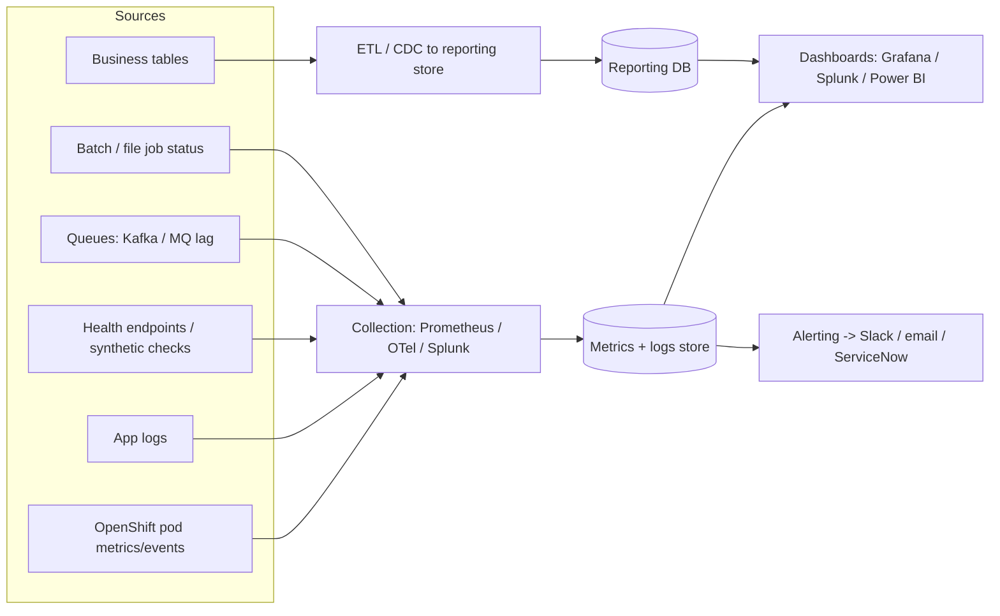

# 360-Degree Dashboard: Delivery Plan

Applications covered (starting set): **Claims Processing, Capitation, Member Preference, Contact**, plus their upstream and downstream systems.

Two views share one foundation:

- **Operational 360:** is each application healthy, and are the flows between them working?
- **Business 360:** volumes, backlog, SLA and quality per domain.

---

## 1. Architecture

The prototype in [`prototype/`](prototype/) implements the right-hand half (reporting DB + Grafana) with sample data.

---

## 2. Phases

### Phase 0: Discovery (weeks 1-2)
1. Fill in the templates in [`templates/`](templates/):
   - [`application-inventory.csv`](templates/application-inventory.csv): one row per application.
   - [`dependency-map.csv`](templates/dependency-map.csv): one row per upstream → downstream interface.
   - [`business-flows.csv`](templates/business-flows.csv): the 5-10 end-to-end flows and their SLAs.
2. Decide the audience (executive, operations, support) and tools (Splunk, Grafana, Power BI, Prometheus).
3. Confirm access to metrics, logs and reporting databases for each application.

**Exit criteria:** every Tier-1 application is in the inventory with an owner, and every Tier-1 flow has a dependency map and SLA.

### Phase 1: Standardise signals (weeks 3-5)

| Signal | Minimum standard |
|---|---|
| Health | `/health` endpoint, readiness and liveness probes |
| Metrics | request rate, error rate, latency, restarts |
| Logs | structured JSON with `app`, `env`, `correlationId` |
| Correlation | one ID propagated across every upstream and downstream call |
| Business events | counters per stage, e.g. `claims_received`, `claims_paid` |
| Batch/file jobs | last run time, status, record count |

Apply the pod-down alerts from [`../openshift-alerts/`](../openshift-alerts/README.md) for infrastructure health.

**Exit criteria:** pilot domain applications meet the contract.

### Phase 2: Data pipeline (weeks 6-9)
- Operational: Prometheus/OTel for metrics, Splunk or Loki for logs, queue-lag exporters.
- Business: never query production databases from dashboards. Use read replicas, CDC, or a scheduled ETL into a reporting store.
- Tag everything with the shared `application` and `domain` names from the inventory.
- Pilot with **Claims** first.

### Phase 3: Dashboards (weeks 10-13)

| Level | Audience | Content |
|---|---|---|
| L1 Executive 360 | Leadership | One tile per domain (green/amber/red), top-line volumes, SLA compliance |
| L2 Domain view | Domain owners | Upstream → downstream flow with health per node, throughput and backlog per hop |
| L3 Application view | Engineers | Pods, restarts, latency, errors, dependencies, deploys |
| L4 Transaction trace | Support | Search a claim or member ID and see where it is in the flow |

The prototype includes L1, L2 and a simple L4.

### Phase 4: Alerting and SLOs (weeks 12-14)
- One SLO per Tier-1 flow, e.g. "95% of claims adjudicated within 4 hours".
- Alert on symptoms (backlog, SLO burn) as well as causes (pod down).
- Route by domain owner. Suppress downstream alerts when an upstream root cause is already firing.

### Phase 5: Roll out and harden (weeks 14-20)
- Onboard Capitation, Member Preference and Contact.
- Add data-freshness and "no data" checks.
- Role-based access. Claims and member data is PHI/PII: mask or aggregate it, and restrict member-level views (L4).
- Compliance and security review before go-live.
- Add an onboarding checklist so new services join the dashboard automatically.

---

## 3. Domain panels

| Domain | Key measures |
|---|---|
| Claims | received / adjudicated / paid per hour, pending age, rejection rate, intake-to-payment time |
| Capitation | monthly run status, record counts, payment file delivery, reconciliation differences |
| Member Preference | updates per hour, failed propagation downstream, sync lag |
| Contact | requests, delivery success, bounce rate, queue depth |
| Cross-cutting | downstream systems marked "impacted" when an upstream one is down |

---

## 4. Tool choices

| Need | Options |
|---|---|
| Operational dashboards | Grafana (Prometheus, Loki, SQL), Splunk, Datadog/Dynatrace |
| Business dashboards | Power BI, Tableau, Grafana with SQL, Splunk |
| Dependency map | Grafana Node Graph, Dynatrace Smartscape, Kiali, or a manual map |
| Alerting | Alertmanager, Splunk alerts, PagerDuty |

If Splunk is already licensed and holds your data, build both views there. Otherwise use Grafana for operational and Power BI for business.

---

## 5. Roles

| Role | Responsibility |
|---|---|
| Sponsor | Priorities, removes blockers |
| Product owner | Dashboard questions, audience feedback |
| Data/BI engineer | Pipeline, reporting store, dashboards |
| Platform/SRE | Metrics, logs, alerting, OpenShift |
| Domain owners (Claims, Capitation, Member Pref, Contact) | Inventory, SLAs, signals contract |
| Security/Compliance | PHI/PII review, access |

---

## 6. Risks

| Risk | Mitigation |
|---|---|
| No shared IDs across systems | Agree the correlation key in Phase 1 |
| Teams don't onboard | Keep the standard small, provide templates, executive sponsorship |
| PHI/PII exposure | Mask data, use roles, involve compliance early |
| Dashboards nobody uses | Design from user questions, keep L1 to one page |
| Legacy/mainframe has no metrics | Use batch status tables, file-arrival checks, log scraping |

---

## 7. Definition of done (pilot)

- Pilot domain in inventory with owner, SLA, dependencies.
- L1-L3 dashboards live and used in a weekly operations review.
- At least two SLO alerts firing to the right channel in a test.
- Compliance sign-off on data shown.
- Onboarding checklist ready for the next domain.
