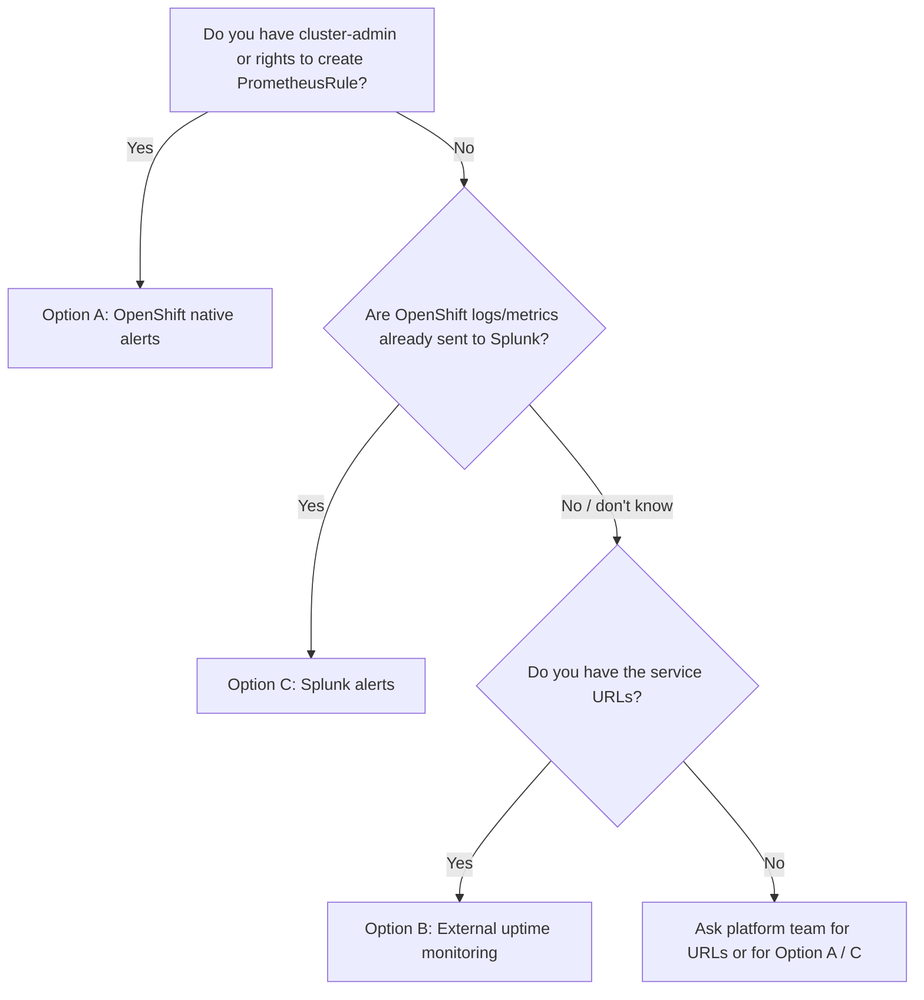

# Pod Down / Not Responding Alerts: All Options

Goal: get an alert when any of your ~100 microservices on OpenShift is **down** or **not responding**.

Which option you can use depends on what access you have. Start with the decision guide.

> Related: building a 360-degree dashboard across Claims, Capitation, Member Preference and Contact? See [`360-dashboard/`](360-dashboard/README.md).

---

## 1. Which option should I use?



| | A. OpenShift native | B. External uptime check | C. Splunk |
|---|---|---|---|
| Needs cluster access | Yes (admin to apply) | **No** | No (needs Splunk access + data already forwarded) |
| Detects "service not responding" | Yes (readiness probe) | Yes (HTTP check) | Yes (from logs/metrics) |
| Detects *why* (crash loop, OOM, pending) | **Yes** | No | Partly (events/logs) |
| Setup effort | Low | Low | Medium |
| Cost | Free (built in) | Free (self-hosted) / paid (SaaS) | Existing Splunk license |
| Best for | Complete solution | Quick start, no access | Companies already on Splunk |

You can combine them. A common approach is B now, then A or C once access is granted.

---

## 2. Option A: OpenShift native alerts (Prometheus + Alertmanager)

Uses what OpenShift already ships. One rule set covers all namespaces and all 100 services.

- **Needs:** `oc` access and cluster-admin (or a platform/SRE team who can run the files for you).
- **Detects:** not ready, Pending/Failed pods, crash loops, ImagePull errors, OOMKilled, deployments with 0 or fewer-than-desired replicas.
- **Full guide and files:** see [`openshift-alerts/README.md`](openshift-alerts/README.md).

| File | Purpose |
|---|---|
| [`openshift-alerts/01-pod-down-alerts.yaml`](openshift-alerts/01-pod-down-alerts.yaml) | The alert rules |
| [`openshift-alerts/02-alertmanager-config.yaml`](openshift-alerts/02-alertmanager-config.yaml) | Sends alerts to Slack/email |
| [`openshift-alerts/03-add-probes.sh`](openshift-alerts/03-add-probes.sh) | Adds readiness/liveness probes |

Quick start (as cluster-admin):
```bash
./openshift-alerts/03-add-probes.sh <namespace> /health 8080
oc apply -f openshift-alerts/01-pod-down-alerts.yaml
# edit the Slack URL in 02-alertmanager-config.yaml, then follow the command in its header
```

**If you have no access:** send the `openshift-alerts/` folder to your platform team and ask them to apply these two files. You can check what you are allowed to do with:
```bash
oc auth can-i create prometheusrules -n <your-namespace>
```
If that returns `yes` and user-workload monitoring is enabled, you can create a `PrometheusRule` in your own namespace without cluster-admin. See section 8 of the OpenShift guide.

---

## 3. Option B: External uptime monitoring (no cluster access needed)

A tool outside the cluster calls each service's health URL on a schedule. If the URL fails or times out, you get an alert.

- **Needs:** a list of URLs (OpenShift Routes or health endpoints) reachable from the monitoring tool.
- **Limitation:** it shows the service is unreachable, not the cause. It cannot see services without a Route.

### B1. Tool choices

| Tool | Type | Notes |
|---|---|---|
| **Uptime Kuma** | Free, self-hosted | Simple UI, Slack/email/Teams alerts |
| **Prometheus Blackbox Exporter + Alertmanager** | Free, self-hosted | Config-file driven, good for 100 targets |
| **Splunk Synthetic Monitoring** | Paid (Splunk Observability Cloud) | Use if you already have Splunk |
| **UptimeRobot, Better Stack, StatusCake, Pingdom** | SaaS | Fast setup, check plan limits for 100 monitors |
| **Datadog Synthetics, Grafana Cloud Synthetic Monitoring** | SaaS | Fuller platforms |

### B2. Recommended free setup: Blackbox Exporter + Prometheus + Alertmanager

Run on any VM or laptop that can reach your Routes. Requires Docker.

**Folder layout**
```
uptime-monitor/
  docker-compose.yml
  prometheus.yml
  alert-rules.yml
  alertmanager.yml
  blackbox.yml
  targets.yml
```

**`targets.yml`: your 100 URLs (one per line)**
```yaml
- targets:
    - https://orders.apps.mycluster.example.com/health
    - https://payments.apps.mycluster.example.com/health
    - https://users.apps.mycluster.example.com/health
    # ...add all 100
```

**`blackbox.yml`: how to check**
```yaml
modules:
  http_2xx:
    prober: http
    timeout: 5s
    http:
      valid_status_codes: []      # any 2xx is OK
      method: GET
      # tls_config:
      #   insecure_skip_verify: true   # only if using self-signed certs
```

**`prometheus.yml`**
```yaml
global:
  scrape_interval: 30s

rule_files:
  - alert-rules.yml

alerting:
  alertmanagers:
    - static_configs:
        - targets: ['alertmanager:9093']

scrape_configs:
  - job_name: blackbox-http
    metrics_path: /probe
    params:
      module: [http_2xx]
    file_sd_configs:
      - files: ['/etc/prometheus/targets.yml']
    relabel_configs:
      - source_labels: [__address__]
        target_label: __param_target
      - source_labels: [__param_target]
        target_label: instance
      - target_label: __address__
        replacement: blackbox:9115
```

**`alert-rules.yml`**
```yaml
groups:
  - name: service-availability
    rules:
      - alert: ServiceDown
        expr: probe_success == 0
        for: 2m
        labels:
          severity: critical
        annotations:
          summary: "{{ $labels.instance }} is down or not responding"

      - alert: ServiceSlow
        expr: probe_duration_seconds > 3
        for: 5m
        labels:
          severity: warning
        annotations:
          summary: "{{ $labels.instance }} is slow ({{ $value | printf \"%.1f\" }}s)"

      - alert: CertificateExpiringSoon
        expr: (probe_ssl_earliest_cert_expiry - time()) / 86400 < 14
        labels:
          severity: warning
        annotations:
          summary: "TLS certificate for {{ $labels.instance }} expires in under 14 days"
```

**`alertmanager.yml`**
```yaml
route:
  receiver: slack
  group_by: [alertname]
  group_wait: 30s
  repeat_interval: 4h
receivers:
  - name: slack
    slack_configs:
      - api_url: https://hooks.slack.com/services/REPLACE/ME/NOW
        channel: "#alerts"
        send_resolved: true
        title: '[{{ .Status | toUpper }}] {{ .CommonLabels.alertname }}'
        text: '{{ range .Alerts }}{{ .Annotations.summary }}{{ "\n" }}{{ end }}'
```

**`docker-compose.yml`**
```yaml
services:
  blackbox:
    image: prom/blackbox-exporter:latest
    volumes:
      - ./blackbox.yml:/etc/blackbox_exporter/config.yml
  prometheus:
    image: prom/prometheus:latest
    volumes:
      - ./prometheus.yml:/etc/prometheus/prometheus.yml
      - ./alert-rules.yml:/etc/prometheus/alert-rules.yml
      - ./targets.yml:/etc/prometheus/targets.yml
    ports:
      - "9090:9090"
  alertmanager:
    image: prom/alertmanager:latest
    volumes:
      - ./alertmanager.yml:/etc/alertmanager/alertmanager.yml
    ports:
      - "9093:9093"
```

**Run it**
```bash
docker compose up -d
```
- Prometheus UI: http://localhost:9090 → **Status → Targets** (all 100 should show UP)
- Alerts: http://localhost:9090/alerts
- To add or remove services, edit `targets.yml`. Prometheus reloads it automatically with no restart.

**Test:** add a bad URL to `targets.yml`. After about 2 minutes `ServiceDown` fires and you get a Slack message.

### B3. Simplest GUI setup: Uptime Kuma

```bash
docker run -d --restart=always -p 3001:3001 -v uptime-kuma:/app/data --name uptime-kuma louislam/uptime-kuma:1
```
1. Open http://localhost:3001 and create an admin account.
2. **Settings → Notifications**: add Slack, email, or Teams.
3. **Add New Monitor**: type `HTTP(s)`, enter the URL, interval 60s, retries 2.
4. Repeat for each service. For 100 services, use the community Python library `uptime-kuma-api` to script creation from a list, or clone monitors in the UI.

### B4. Splunk Synthetic Monitoring (if your company licenses Splunk Observability Cloud)
1. Go to **Synthetics → Create test → Uptime test (HTTP)**.
2. Enter the URL, choose frequency (for example 1 minute), and pick locations.
3. Add a **detector/alert** that notifies Slack, email, or PagerDuty on failure.
4. Repeat per service (or use the Splunk API to create tests from a list).

### B5. Make the health endpoint meaningful
Use a real health path such as `/health` or `/actuator/health`, not `/`. Ideally it checks the app's key dependencies (DB, queue) so "healthy" actually means working.

---

## 4. Option C: Splunk

Use this if your platform team already forwards OpenShift data to Splunk. You can create alerts without cluster access.

**First ask your platform team:**
1. Are OpenShift pod **logs**, **Kubernetes events**, and **metrics** sent to Splunk?
2. Which **index** and **sourcetype** names are used?
3. Is this **Splunk Enterprise/Cloud** (logs/events) or **Splunk Observability Cloud** (metrics)?

Field and sourcetype names below are examples. Replace them with what your environment uses.

### C1. Splunk Enterprise / Cloud: alerts from Kubernetes events

Detect pod problems from cluster events (requires events to be forwarded, for example via Splunk Connect for Kubernetes, the Splunk OpenTelemetry Collector, or OpenShift Logging forwarding):

```spl
index=openshift sourcetype="kube:objects:events"
  (object.reason="BackOff" OR object.reason="Unhealthy" OR object.reason="Failed"
   OR object.reason="FailedScheduling" OR object.reason="OOMKilling")
| stats count latest(_time) as last_seen by object.involvedObject.namespace, object.involvedObject.name, object.reason
| where count >= 3
```

Save it:
1. **Save As → Alert**
2. Type: **Scheduled**, run every **5 minutes**, time range **last 10 minutes**
3. Trigger: **Number of results > 0**
4. Action: **Send email** or **Slack webhook**

### C2. Splunk Enterprise / Cloud: "silence" alert (service stopped logging)

If a service normally logs continuously, no logs for a few minutes can mean it is down or hung. This does not need cluster access:

```spl
| tstats latest(_time) as last_log where index=openshift by host
| eval minutes_silent = round((now() - last_log) / 60, 1)
| where minutes_silent > 5
```

Adjust `by host` to the field that identifies a service or pod, such as `kubernetes.pod_name` or `source`. Skip this for services that are quiet by nature, or you will get false alarms.

### C3. Splunk Enterprise / Cloud: error spike in app logs
```spl
index=openshift namespace="shop" ("ERROR" OR "Exception" OR "Connection refused")
| stats count by pod
| where count > 20
```
Run every 5 minutes over the last 5 minutes.

### C4. Splunk Observability Cloud: detectors on metrics

If the Splunk OpenTelemetry Collector sends Kubernetes metrics, create detectors (**Alerts & Detectors → New Detector**) on metrics such as:

| Goal | Metric (check exact names in the Metric Finder) | Condition |
|---|---|---|
| Pod failed or unknown | `k8s.pod.phase` | value is 4 (Failed) or 5 (Unknown) for 5 min |
| Container restarting | `k8s.container.restarts` | increase of more than 3 in 15 min |
| Deployment has fewer pods than desired | `k8s.deployment.available` vs `k8s.deployment.desired` | available < desired for 5 min |

Use **Alert on: group by `k8s.namespace.name`, `k8s.deployment.name`** so one detector covers all 100 services. Set the notification target to Slack, email, or PagerDuty.

---

## 5. Recommended rollout

1. **Today, no access needed:** set up Option B (Blackbox Exporter or Uptime Kuma) with all 100 URLs.
2. **Ask the platform team** (copy-paste this):
   > Please apply `openshift-alerts/01-pod-down-alerts.yaml` and configure Alertmanager with our Slack webhook, or confirm that OpenShift pod metrics and events are in Splunk and share the index/sourcetype.
3. **Once available:** keep Option B for user-facing availability, and add Option A or C for root-cause detail (crash loops, OOM, pending pods).

Why both: the external check tells you users can't reach the service, and the internal alerts tell you why.

---

## 6. Common requirements for all options

- **Every service needs a health endpoint** (`/health`, `/actuator/health`, `/healthz`).
- **Readiness and liveness probes** should be set on every Deployment (Options A and C rely on them to detect a hung app). See `03-add-probes.sh`.
- **Avoid alert fatigue:** use a wait period (`for: 2m` or more) and send `critical` and `warning` to different channels.
- **Test alerts** before relying on them: scale a test service to 0, or add a bad URL.
- **Keep secrets out of git:** do not commit real Slack webhook URLs or SMTP passwords.

---

## 7. Troubleshooting

| Problem | Likely cause / fix |
|---|---|
| Blackbox target always DOWN | URL not reachable from the monitoring host (firewall/VPN/proxy), or self-signed cert (enable `insecure_skip_verify` for testing) |
| `probe_success` is 1 but the app is broken | Health path only returns 200 without checking dependencies; improve the health endpoint |
| No Slack message | Wrong webhook URL; check `docker compose logs alertmanager` |
| Too many false alerts | Increase `for:` duration or retries; avoid 1-minute-only checks |
| Splunk search returns nothing | Wrong index/sourcetype/field names; confirm with the platform team and inspect raw events |
| `oc apply` permission denied | You lack cluster-admin; send the files to your platform team |
