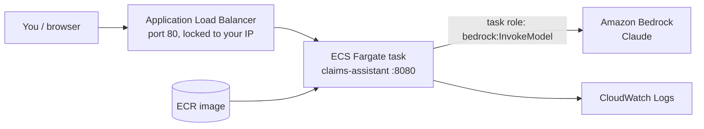

# Deploy the Claims Assistant on AWS

Target: **Amazon ECS on Fargate** behind an **Application Load Balancer**, with **Claude on Amazon Bedrock** called through an IAM task role (no API keys to store).



> **Status:** these steps have **not been run**. This machine has no AWS CLI, Terraform, or AWS account access. Treat the commands as a checked draft and expect to fix small things (names, quotas, model IDs) on the first run.

> **Do not put real member data here.** The prototype uses hard-coded demo tokens and in-memory synthetic data. This guide is for a **demo or test environment**. See section 9 before anything real.

---

## 0. Prerequisites

- An AWS account and an IAM user or role that can create ECR, ECS, IAM, EC2 (load balancer, security groups), CloudWatch Logs, and use Bedrock.
- [AWS CLI v2](https://docs.aws.amazon.com/cli/latest/userguide/getting-started-install.html): `brew install awscli`, then `aws configure` (or `aws sso login`).
- Docker running (on this Mac: `colima start`).
- **Bedrock model access:** in the AWS console go to **Amazon Bedrock → Model access** and request access to an Anthropic Claude model in your region. Note its **model ID** (some models require a cross-region *inference profile* ID such as `us.anthropic.claude-...`; copy the exact ID from the console).

Set variables once per terminal session:

```bash
export AWS_REGION=us-east-1
export APP=claims-assistant
export ACCOUNT_ID=$(aws sts get-caller-identity --query Account --output text)
export BEDROCK_MODEL_ID="<paste the model or inference-profile ID from the Bedrock console>"
aws sts get-caller-identity     # confirm you are in the right account
```

---

## 1. Build and push the image to ECR

```bash
cd claims-assistant

aws ecr create-repository --repository-name $APP --region $AWS_REGION \
  --image-scanning-configuration scanOnPush=true

aws ecr get-login-password --region $AWS_REGION | \
  docker login --username AWS --password-stdin $ACCOUNT_ID.dkr.ecr.$AWS_REGION.amazonaws.com

# Apple Silicon Macs build arm64 by default. Fargate below uses x86_64, so build for amd64.
docker build --platform linux/amd64 -t $APP:0.1.0 .
docker tag  $APP:0.1.0 $ACCOUNT_ID.dkr.ecr.$AWS_REGION.amazonaws.com/$APP:0.1.0
docker push $ACCOUNT_ID.dkr.ecr.$AWS_REGION.amazonaws.com/$APP:0.1.0
```

---

## 2. IAM roles

Two roles are needed:

| Role | Used by | Permissions |
|---|---|---|
| **Execution role** | ECS agent | Pull image from ECR, write logs |
| **Task role** | Your app code | Call Bedrock only |

```bash
cat > /tmp/ecs-trust.json <<'EOF'
{ "Version": "2012-10-17",
  "Statement": [{ "Effect": "Allow",
    "Principal": { "Service": "ecs-tasks.amazonaws.com" },
    "Action": "sts:AssumeRole" }] }
EOF

# Execution role
aws iam create-role --role-name ${APP}-exec --assume-role-policy-document file:///tmp/ecs-trust.json
aws iam attach-role-policy --role-name ${APP}-exec \
  --policy-arn arn:aws:iam::aws:policy/service-role/AmazonECSTaskExecutionRolePolicy

# Task role (least privilege: Bedrock invoke only)
aws iam create-role --role-name ${APP}-task --assume-role-policy-document file:///tmp/ecs-trust.json
cat > /tmp/bedrock-invoke.json <<'EOF'
{ "Version": "2012-10-17",
  "Statement": [{ "Effect": "Allow",
    "Action": ["bedrock:InvokeModel", "bedrock:InvokeModelWithResponseStream"],
    "Resource": "*" }] }
EOF
aws iam put-role-policy --role-name ${APP}-task --policy-name bedrock-invoke \
  --policy-document file:///tmp/bedrock-invoke.json
```

Tighten `"Resource": "*"` to the specific model and inference-profile ARNs once it works.

---

## 3. Network and load balancer

This uses the **default VPC** for speed. Production should use private subnets (section 9).

```bash
export VPC_ID=$(aws ec2 describe-vpcs --filters Name=isDefault,Values=true --query 'Vpcs[0].VpcId' --output text)
export SUBNETS=$(aws ec2 describe-subnets --filters Name=vpc-id,Values=$VPC_ID \
  --query 'Subnets[0:2].SubnetId' --output text)          # two subnets in different AZs
export SUBNET_CSV=$(echo $SUBNETS | tr ' ' ',')
export MY_IP=$(curl -s https://checkip.amazonaws.com)

# Security group for the load balancer: only YOUR IP (the app has demo tokens, so do not open it to the internet)
export ALB_SG=$(aws ec2 create-security-group --group-name ${APP}-alb --description "ALB for $APP" \
  --vpc-id $VPC_ID --query GroupId --output text)
aws ec2 authorize-security-group-ingress --group-id $ALB_SG --protocol tcp --port 80 --cidr ${MY_IP}/32

# Security group for the tasks: only the load balancer can reach port 8080
export TASK_SG=$(aws ec2 create-security-group --group-name ${APP}-task --description "Tasks for $APP" \
  --vpc-id $VPC_ID --query GroupId --output text)
aws ec2 authorize-security-group-ingress --group-id $TASK_SG --protocol tcp --port 8080 --source-group $ALB_SG

# Load balancer, target group, listener
export ALB_ARN=$(aws elbv2 create-load-balancer --name $APP --subnets $SUBNETS --security-groups $ALB_SG \
  --query 'LoadBalancers[0].LoadBalancerArn' --output text)
export TG_ARN=$(aws elbv2 create-target-group --name $APP --protocol HTTP --port 8080 --vpc-id $VPC_ID \
  --target-type ip --health-check-path /health --query 'TargetGroups[0].TargetGroupArn' --output text)
aws elbv2 create-listener --load-balancer-arn $ALB_ARN --protocol HTTP --port 80 \
  --default-actions Type=forward,TargetGroupArn=$TG_ARN
export ALB_DNS=$(aws elbv2 describe-load-balancers --load-balancer-arns $ALB_ARN --query 'LoadBalancers[0].DNSName' --output text)
echo $ALB_DNS
```

---

## 4. ECS cluster, task definition, and service

```bash
aws logs create-log-group --log-group-name /ecs/$APP
aws ecs create-cluster --cluster-name $APP

cat > /tmp/taskdef.json <<EOF
{
  "family": "$APP",
  "requiresCompatibilities": ["FARGATE"],
  "networkMode": "awsvpc",
  "cpu": "256",
  "memory": "512",
  "runtimePlatform": { "cpuArchitecture": "X86_64", "operatingSystemFamily": "LINUX" },
  "executionRoleArn": "arn:aws:iam::$ACCOUNT_ID:role/${APP}-exec",
  "taskRoleArn": "arn:aws:iam::$ACCOUNT_ID:role/${APP}-task",
  "containerDefinitions": [{
    "name": "$APP",
    "image": "$ACCOUNT_ID.dkr.ecr.$AWS_REGION.amazonaws.com/$APP:0.1.0",
    "essential": true,
    "portMappings": [{ "containerPort": 8080 }],
    "environment": [
      { "name": "LLM_PROVIDER", "value": "bedrock" },
      { "name": "AWS_REGION",   "value": "$AWS_REGION" },
      { "name": "LLM_MODEL",    "value": "$BEDROCK_MODEL_ID" }
    ],
    "logConfiguration": { "logDriver": "awslogs", "options": {
      "awslogs-group": "/ecs/$APP", "awslogs-region": "$AWS_REGION", "awslogs-stream-prefix": "ecs" } }
  }]
}
EOF
aws ecs register-task-definition --cli-input-json file:///tmp/taskdef.json

aws ecs create-service --cluster $APP --service-name $APP --task-definition $APP --desired-count 2 \
  --launch-type FARGATE \
  --network-configuration "awsvpcConfiguration={subnets=[$SUBNET_CSV],securityGroups=[$TASK_SG],assignPublicIp=ENABLED}" \
  --load-balancers "targetGroupArn=$TG_ARN,containerName=$APP,containerPort=8080" \
  --health-check-grace-period-seconds 30
```

`assignPublicIp=ENABLED` is needed in the default VPC so tasks can pull from ECR and reach Bedrock without a NAT gateway.

To run **without Claude** first (no Bedrock access needed), remove the three `environment` entries or set `LLM_PROVIDER` to `offline`.

---

## 5. Test

Wait 1 to 3 minutes for the tasks to become healthy:

```bash
aws ecs describe-services --cluster $APP --services $APP \
  --query 'services[0].{running:runningCount,desired:desiredCount,events:events[0].message}'

curl -s http://$ALB_DNS/health
curl -s -X POST http://$ALB_DNS/chat \
  -H "Authorization: Bearer demo-token-m1001" -H "Content-Type: application/json" \
  -d '{"message":"Why was CLM-000102 denied?"}'
```

`/health` should show `"llm_provider":"bedrock"`. You can also open `http://<ALB_DNS>` in a browser from your IP.

Then run the quality evaluation against Bedrock from your own machine, with AWS credentials set:

```bash
LLM_PROVIDER=bedrock AWS_REGION=$AWS_REGION LLM_MODEL=$BEDROCK_MODEL_ID \
  .venv/bin/python -m eval.run_eval --threshold 0.95
```

---

## 6. Update the app

```bash
docker build --platform linux/amd64 -t $APP:0.1.1 .
docker tag $APP:0.1.1 $ACCOUNT_ID.dkr.ecr.$AWS_REGION.amazonaws.com/$APP:0.1.1
docker push $ACCOUNT_ID.dkr.ecr.$AWS_REGION.amazonaws.com/$APP:0.1.1
# change the image tag in /tmp/taskdef.json, then:
aws ecs register-task-definition --cli-input-json file:///tmp/taskdef.json
aws ecs update-service --cluster $APP --service $APP --task-definition $APP
```

---

## 7. Troubleshooting

| Problem | Likely cause and fix |
|---|---|
| Tasks keep stopping | `aws ecs describe-tasks` and the CloudWatch log group `/ecs/claims-assistant`. `exec format error` means the image was built for the wrong CPU: rebuild with `--platform linux/amd64`. |
| `CannotPullContainerError` | No route to ECR: use `assignPublicIp=ENABLED` or add a NAT gateway or VPC endpoints. |
| ALB targets unhealthy | Task security group must allow 8080 from the ALB security group. Health path is `/health`. |
| 503 from ALB | No healthy targets yet. Wait, or check the previous two rows. |
| Answers look like templates even with Bedrock | The Bedrock call failed and the app fell back safely. Check logs and: model access granted, `LLM_MODEL` is correct for your region (inference profile ID?), task role has `bedrock:InvokeModel`. |
| `AccessDeniedException` from Bedrock | Request model access in the Bedrock console and check the task role policy. |
| Cannot reach the ALB from your browser | Your IP changed. Re-run the `authorize-security-group-ingress` command with your new IP. |

---

## 8. Clean up (avoid charges)

The load balancer and Fargate tasks bill by the hour. Remove everything when done:

```bash
aws ecs update-service --cluster $APP --service $APP --desired-count 0
aws ecs delete-service --cluster $APP --service $APP --force
aws ecs delete-cluster --cluster $APP
LISTENER_ARN=$(aws elbv2 describe-listeners --load-balancer-arn $ALB_ARN --query 'Listeners[0].ListenerArn' --output text)
aws elbv2 delete-listener --listener-arn $LISTENER_ARN
aws elbv2 delete-load-balancer --load-balancer-arn $ALB_ARN
sleep 60
aws elbv2 delete-target-group --target-group-arn $TG_ARN
aws ec2 delete-security-group --group-id $TASK_SG
aws ec2 delete-security-group --group-id $ALB_SG
aws logs delete-log-group --log-group-name /ecs/$APP
aws ecr delete-repository --repository-name $APP --force
aws iam delete-role-policy --role-name ${APP}-task --policy-name bedrock-invoke
aws iam delete-role --role-name ${APP}-task
aws iam detach-role-policy --role-name ${APP}-exec --policy-arn arn:aws:iam::aws:policy/service-role/AmazonECSTaskExecutionRolePolicy
aws iam delete-role --role-name ${APP}-exec
```

If a security group delete fails, wait a minute for the network interfaces to detach, then retry.

---

## 9. Before real member data (PHI)

The steps above are a demo. For real data, close these gaps first:

| Area | Required change |
|---|---|
| **HIPAA agreements** | Sign the **BAA in AWS Artifact**. Use only HIPAA-eligible services and confirm Bedrock and the chosen model are covered. Get compliance sign-off. |
| **Authentication** | Replace the hard-coded `TOKENS` in `app/data.py` and `current_member` in `app/main.py` with OIDC token validation (for example Amazon Cognito or your corporate IdP). |
| **Data** | Replace the in-memory data with a read-only claims API or read replica, member-scoped. |
| **HTTPS** | ACM certificate on the ALB, HTTPS listener, redirect 80 to 443. |
| **Network** | Run tasks in **private subnets**, with **VPC endpoints** for ECR, S3, CloudWatch Logs, and Bedrock Runtime. Set `assignPublicIp=DISABLED`. |
| **Edge protection** | AWS WAF on the ALB, rate limiting. |
| **Secrets** | AWS Secrets Manager for any keys (not needed for Bedrock with a task role). |
| **Encryption and logging** | KMS keys, CloudTrail, encrypted log groups, log retention policy. Keep PHI out of logs (the app already omits message text). |
| **Scaling and resilience** | ECS service auto scaling, tasks across at least two AZs, alarms on 5xx and latency. |
| **Infrastructure as code** | Move these commands to Terraform or CloudFormation, with separate dev, staging and prod accounts. |
| **CI/CD** | Pipeline that runs `pytest` and `eval.run_eval --threshold 0.95`, scans the image, then deploys. |
| **Monitoring** | Add the service to the [360 dashboard](../360-dashboard/README.md) inventory and alerts. |

The full target design is in [`PLAN.md`](PLAN.md), section 7.

---

## Simpler alternative: AWS App Runner

App Runner runs a container from ECR with HTTPS and scaling, in a few commands. It gives up the network control of ECS, so ECS is the better path for PHI workloads in private subnets. For a quick demo:

1. Push the image to ECR (section 1).
2. In the console, **App Runner → Create service → Container registry → Amazon ECR**.
3. Port `8080`, health check path `/health`.
4. Environment variables: `LLM_PROVIDER=bedrock`, `AWS_REGION`, `LLM_MODEL`.
5. Instance role: allow `bedrock:InvokeModel`.
6. Delete the service when finished.
