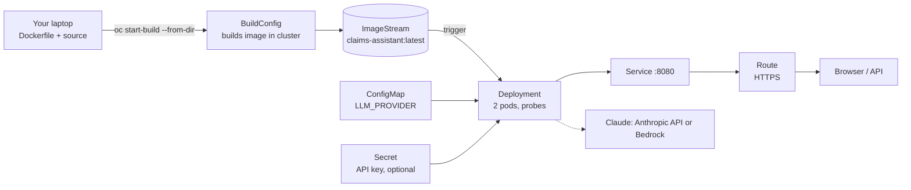

# Deploy the Claims Assistant on OpenShift (OCP)

Works on any OpenShift 4.x cluster: on-prem OCP, ROSA (AWS), ARO (Azure), OpenShift on IBM Cloud, or the free Developer Sandbox.

> **Status:** not run. This machine has no `oc` CLI and no cluster access. The YAML files were checked for valid syntax only. Expect small fixes on the first run (project names, quotas, cluster policies).

> **Demo only.** The app still has hard-coded demo tokens and synthetic in-memory data. Do not load real member data. See section 8.



## Files

| File | Creates |
|---|---|
| [`openshift/01-configmap.yaml`](openshift/01-configmap.yaml) | Settings such as `LLM_PROVIDER` |
| [`openshift/10-deployment.yaml`](openshift/10-deployment.yaml) | 2 pods, readiness and liveness probes, resource limits, non-root, auto-redeploy on new image |
| [`openshift/20-service-route.yaml`](openshift/20-service-route.yaml) | Internal Service and an HTTPS Route |
| [`openshift/30-scaling-and-security.yaml`](openshift/30-scaling-and-security.yaml) | Autoscaler (2 to 6 pods), PodDisruptionBudget, NetworkPolicy |

---

## 1. Prerequisites

- The `oc` CLI: `brew install openshift-cli`
- A cluster URL and a login. In the web console click your name, then **Copy login command**, and run it:
  ```bash
  oc login --token=<token> --server=https://api.<cluster>:6443
  oc whoami
  ```
- Permission to create a project (namespace) and builds. You do **not** need cluster-admin.

---

## 2. Create a project

```bash
oc new-project claims-assistant
```
If you cannot create projects, ask your platform team for a namespace and run `oc project <name>` instead.

---

## 3. Build the image inside the cluster

No Docker or external registry is needed. OpenShift builds from the `Dockerfile` and stores the result in its internal registry.

```bash
cd claims-assistant

oc new-build --name=claims-assistant --binary --strategy=docker
oc start-build claims-assistant --from-dir=. --follow
```
Wait for `Push successful`, then confirm:
```bash
oc get imagestream claims-assistant
```
Excluded files: `.venv` is large and not needed. If the upload is slow, build from a clean copy: `mkdir /tmp/ca && rsync -a --exclude .venv --exclude __pycache__ ./ /tmp/ca/ && oc start-build claims-assistant --from-dir=/tmp/ca --follow`.

*Alternative:* build from Git instead (`oc new-build <git-url> --strategy=docker --context-dir=claims-assistant --name=claims-assistant`), or push your own image to Quay or ECR and reference it in the Deployment.

---

## 4. Deploy

```bash
oc apply -f openshift/01-configmap.yaml
oc apply -f openshift/10-deployment.yaml
oc apply -f openshift/20-service-route.yaml
oc apply -f openshift/30-scaling-and-security.yaml

oc rollout status deploy/claims-assistant
oc get pods -l app=claims-assistant
```
Expected: two pods `1/1 Running`.

---

## 5. Test

```bash
export HOST=$(oc get route claims-assistant -o jsonpath='{.spec.host}')
curl -s https://$HOST/health
curl -s -X POST https://$HOST/chat \
  -H "Authorization: Bearer demo-token-m1001" -H "Content-Type: application/json" \
  -d '{"message":"Why was CLM-000102 denied?"}'
```
`/health` should show `"llm_provider":"offline"`. Open `https://$HOST` in a browser for the chat page. Add `-k` to `curl` if the cluster uses a self-signed router certificate.

Without a public route (e.g. private network), test through a port-forward:
```bash
oc port-forward deploy/claims-assistant 8090:8080   # then http://localhost:8090
```

---

## 6. Turn on Claude

### Anthropic API
```bash
oc create secret generic claims-assistant-llm --from-literal=ANTHROPIC_API_KEY='sk-ant-...'
oc patch configmap claims-assistant-config --type merge -p '{"data":{"LLM_PROVIDER":"anthropic"}}'
oc rollout restart deploy/claims-assistant
```
Optional model: `oc patch configmap claims-assistant-config --type merge -p '{"data":{"LLM_MODEL":"<model-id>"}}'`

### AWS Bedrock
```bash
oc create secret generic claims-assistant-llm \
  --from-literal=AWS_ACCESS_KEY_ID='...' --from-literal=AWS_SECRET_ACCESS_KEY='...'
oc patch configmap claims-assistant-config --type merge \
  -p '{"data":{"LLM_PROVIDER":"bedrock","AWS_REGION":"us-east-1","LLM_MODEL":"<bedrock model or inference profile id>"}}'
oc rollout restart deploy/claims-assistant
```
On **ROSA**, prefer an IAM role through STS/IRSA instead of static keys. Ask your platform team how your cluster is set up.

Check it worked: `curl -s https://$HOST/health` should show the new provider. If answers still look like templates, the model call failed and the app fell back safely: read the logs (section 7).

Use a **dedicated, restricted API key or IAM user** and rotate it. Never put keys in the ConfigMap or in git.

---

## 7. Operate

| Task | Command |
|---|---|
| Logs | `oc logs deploy/claims-assistant --tail=50` (look for `audit` lines) |
| Pod problems | `oc describe pod -l app=claims-assistant` |
| Scale | `oc scale deploy/claims-assistant --replicas=3` (the autoscaler may override) |
| Deploy a new version | `oc start-build claims-assistant --from-dir=. --follow` (the image trigger redeploys) |
| Roll back | `oc rollout undo deploy/claims-assistant` |
| Remove everything | `oc delete project claims-assistant` |

**Alerts and dashboard:** the Deployment already has readiness and liveness probes, so the pod alerts in [`../openshift-alerts/`](../openshift-alerts/README.md) cover this service. Add it to the [360 dashboard inventory](../360-dashboard/templates/application-inventory.csv).

### Troubleshooting

| Symptom | Likely fix |
|---|---|
| `ImagePullBackOff` | The build has not finished or failed. `oc get builds`, `oc logs build/claims-assistant-1`. |
| Pod stuck `Pending` | Project quota or no capacity. `oc describe pod`, check `oc describe quota`. |
| `CrashLoopBackOff` | `oc logs deploy/claims-assistant --previous`. A bad `LLM_PROVIDER` value stops startup with a clear message. |
| Pod rejected by security (SCC) | The image runs as a non-root user and works with the default `restricted` policy. If your cluster is stricter, ask which user ID range is allowed. |
| Read-only filesystem error | If a change makes the app write files, add an `emptyDir` volume mounted at that path, or remove `readOnlyRootFilesystem`. |
| Route returns 503 | No ready pods. `oc get pods`, check the probes. |
| Cannot reach the app from outside | The NetworkPolicy only allows the OpenShift router and monitoring. Use the Route, not a direct pod IP. |
| `Forbidden` creating resources | Ask for edit rights on the project. |

---

## 8. Before real member data (PHI)

| Area | Required change |
|---|---|
| Compliance | HIPAA review, a BAA with any hosted LLM provider, and approval from security and compliance |
| Authentication | Replace the demo `TOKENS` in `app/data.py` and `current_member` in `app/main.py` with OIDC validation (Red Hat SSO/Keycloak, your IdP), or put an OAuth proxy in front |
| Data | A read-only, member-scoped claims API, not the in-memory sample |
| Route | Use your organisation's certificate, restrict by IP allow-list or keep it internal-only |
| Secrets | Use your vault (External Secrets or Vault) instead of plain Secrets |
| Egress | An egress firewall or NetworkPolicy allowing only the LLM endpoint |
| Delivery | GitOps (Argo CD / OpenShift GitOps) and a pipeline (OpenShift Pipelines) that runs `pytest` and `eval.run_eval --threshold 0.95` before deploy |
| Environments | Separate dev, test and prod projects or clusters |

Full design: [`PLAN.md`](PLAN.md), section 7.

---

## Quick copy-paste (everything)

```bash
oc login --token=<token> --server=https://api.<cluster>:6443
oc new-project claims-assistant
cd claims-assistant
oc new-build --name=claims-assistant --binary --strategy=docker
oc start-build claims-assistant --from-dir=. --follow
oc apply -f openshift/
oc rollout status deploy/claims-assistant
curl -s https://$(oc get route claims-assistant -o jsonpath='{.spec.host}')/health
```
