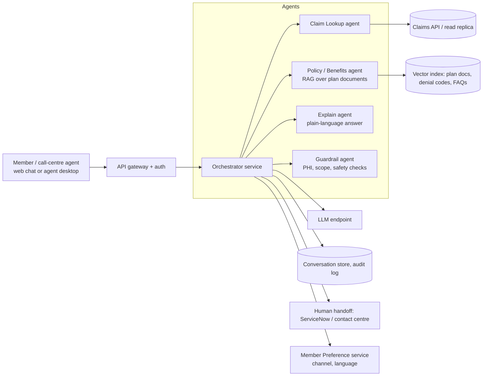
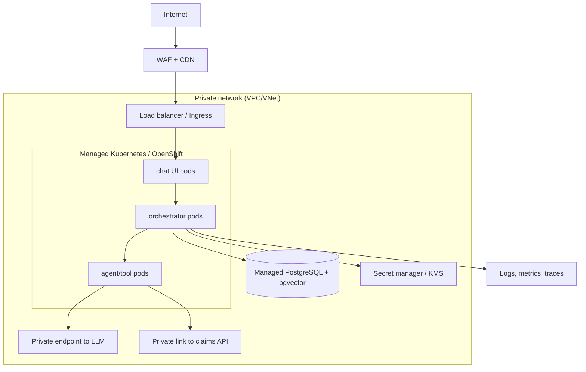

# Claims Inquiry and Denial-Explanation Assistant: Develop and Deploy Plan

A member (or call-centre agent) asks about a claim in plain language. The assistant finds the claim, explains the status or denial, suggests next steps, and escalates to a human when needed.

Example questions:
- "What is the status of claim CLM-000123?"
- "Why was my claim denied?"
- "How much do I still owe on my deductible?"
- "How do I appeal?"

---

## 1. Scope

### Phase 1 (MVP): read-only
- Claim status lookup
- Denial reason explained in plain language (denial code + plan rule)
- Next-step guidance (appeal steps, what to send, deadlines)
- Handoff to a human agent with a conversation summary

### Out of scope for MVP
- Changing or reprocessing claims
- Clinical or medical advice
- Payments
- Prior authorization decisions

### Success measures
| Metric | Target (pilot) |
|---|---|
| Answers judged correct by reviewers | ≥ 95% |
| Contained without human handoff | ≥ 40% |
| Time to answer | < 5 s |
| Member satisfaction (thumbs up) | ≥ 80% |
| PHI leaks or unauthorised access | 0 |

---

## 2. Architecture

### Components
| Component | Purpose |
|---|---|
| **API gateway + auth** | Member login (OIDC/SSO), rate limits, WAF |
| **Orchestrator** | Routes the question to agents, combines results, enforces rules |
| **Claim Lookup agent** | Calls the claims API with the **authenticated member's ID only** (never a value typed by the user) |
| **Policy/Benefits agent** | Retrieval over plan documents, denial code tables, and appeals policy |
| **Explain agent** | Writes the plain-language answer from retrieved facts only |
| **Guardrail agent** | Blocks out-of-scope requests (medical advice), checks the answer cites sources, redacts extra PHI |
| **Audit log** | Who asked what, what data was read, what was answered |

### Key design rules
1. **The LLM never queries the database.** Tools are fixed, parameterised API calls scoped to the logged-in member.
2. **Answers must be grounded.** If the claim or policy source is missing, say "I can't find that" and offer a human.
3. **Show sources.** Every answer lists the claim fields and policy section used.
4. **Human fallback always available.**

---

## 3. Technology choices

Pick one in each row. The defaults suit a team already on OpenShift.

| Layer | Default | Alternatives |
|---|---|---|
| Language | Python 3.11 | Java/Kotlin |
| API | FastAPI | Spring Boot |
| Agent framework | LangGraph | CrewAI, AutoGen, plain code |
| LLM | Enterprise-approved hosted model with a BAA (HIPAA) | Self-hosted open model on GPU nodes |
| Vector store | pgvector (PostgreSQL) | OpenSearch, Milvus, managed vector DB |
| App DB | PostgreSQL | Managed Postgres |
| Auth | OIDC (Keycloak / cloud IdP) | Okta, Azure AD |
| Frontend | React chat widget | Embed in the existing member portal |
| CI/CD | GitHub Actions or Tekton + Argo CD | Jenkins |
| IaC | Terraform | Bicep, CloudFormation |
| Observability | Prometheus + Grafana + Loki / OpenTelemetry | Splunk, Datadog |

Cloud: any of AWS, Azure, GCP or IBM Cloud with a managed Kubernetes or OpenShift service, and the LLM provider's HIPAA terms signed. Choose based on where your claims data and your enterprise agreements already sit.

---

## 4. Data and knowledge

| Source | Use | How |
|---|---|---|
| Claims (status, codes, amounts, dates) | Lookup | Read-only API or read replica. **Not** production write DB. |
| Denial reason codes (CARC/RARC) and internal mappings | Explanation | Reference table, versioned |
| Plan documents, Summary of Benefits, appeals policy, FAQs | Retrieval | Chunk, embed, index with plan ID and effective-date metadata |
| Member preference | Language and channel | Existing Member Preference service |

Rules:
- Filter retrieval by the member's **plan and effective date**, so they never see another plan's rules.
- Re-index when documents change, with versioning and an approval step.

---

## 5. Security and compliance (HIPAA)

This is the highest-risk part. Involve compliance and security in week 1, not at the end.

| Control | Detail |
|---|---|
| Signed agreements | A BAA with the cloud provider and the LLM provider before any real PHI is sent |
| Data minimisation | Send the LLM only the fields needed for the answer; mask names, addresses and full IDs where possible |
| Auth and access | Member can only see their own claims; agents see only assigned members; role-based access |
| Encryption | TLS in transit; encryption at rest with customer-managed keys |
| Network | Private networking, no public database endpoints, egress allow-list to the LLM endpoint |
| Secrets | Cloud secret manager or Vault. Never in git. |
| Logging | Audit trail of every access. Redact PHI in app logs. Retention per policy. |
| Prompt injection | Treat retrieved text and user input as untrusted; tools can't be expanded by prompts; output checks |
| Testing environments | Synthetic data only in dev and test |
| Review | Security review and threat model before the pilot; pen test before broad release |

---

## 6. Phased delivery

### Phase 0: Discovery and approvals (weeks 1-2)
- Confirm the scope, success metrics and owners.
- Compliance kickoff: LLM and cloud BAAs, data-handling rules.
- Identify the claims API or replica, and the plan document sources.
- Collect 100-200 real (de-identified) historical member questions for testing.
- **Exit:** approved scope, data access agreed, risk register started.

### Phase 1: Prototype on synthetic data (weeks 3-5)
- Build the Claim Lookup agent against a mock claims API.
- Index sample plan documents and the denial code table.
- Orchestrator + Explain agent + basic web chat.
- Create an **evaluation set** (question → expected facts) and a script to score it.
- **Exit:** ≥ 85% on the evaluation set on synthetic data; demo to stakeholders.

### Phase 2: Harden for real integration (weeks 6-9)
- Real claims API integration (read-only, member-scoped).
- Auth with SSO; per-member authorization checks tested.
- Guardrail agent, grounding checks, citations, human handoff.
- Audit logging, PHI redaction, rate limits.
- Security review and threat model.
- **Exit:** security sign-off; ≥ 95% on the evaluation set; red-team tests (prompt injection, cross-member data requests) all blocked.

### Phase 3: Cloud platform and CI/CD (parallel, weeks 4-9)
See section 7.

### Phase 4: Pilot (weeks 10-13)
- Limited group: internal call-centre agents first ("agent assist"), then a small member group.
- Human review of a sample of answers daily.
- Dashboards and alerts live.
- **Exit:** metrics meet targets for 2 consecutive weeks, zero PHI incidents.

### Phase 5: General release and improvement (weeks 14+)
- Staged rollout (10% → 50% → 100%).
- Add languages, channels (voice, SMS) using Member Preference.
- Candidate next features: appeal letter drafting, prior-auth status, benefit questions.

---

## 7. Cloud deployment plan

### 7.1 Environments
| Env | Data | Purpose |
|---|---|---|
| dev | Synthetic | Daily development |
| test/staging | Synthetic (and de-identified, if approved) | Integration, evaluation runs, load tests |
| prod | Real PHI | Pilot and release |

Separate cloud accounts/subscriptions or projects per environment. No shared databases.

### 7.2 Target topology

### 7.3 Build and release pipeline
1. **Code**: Git repo, pull requests, required review.
2. **CI** on each PR: lint, unit tests, dependency and container scan, secret scan, **evaluation-set regression run** (fails the build if accuracy drops).
3. **Build**: container image, signed, pushed to a private registry.
4. **CD**: GitOps (Argo CD) deploys to dev automatically; staging on merge; prod needs manual approval.
5. **Rollback**: previous image tag; database migrations backwards-compatible.

### 7.4 Infrastructure as code
Terraform modules for: network, Kubernetes cluster, database, secrets/KMS, registry, monitoring. No manual console changes in prod.

### 7.5 Kubernetes configuration
- One namespace per environment; network policies deny by default.
- Resource requests/limits on every pod; autoscaling (HPA) on CPU and request rate.
- Readiness and liveness probes on every service. (This ties directly to the pod alerts in [`../openshift-alerts/`](../openshift-alerts/README.md).)
- Pod security: non-root, read-only filesystem, no privilege escalation.
- At least 2 replicas per service across zones.

### 7.6 Operations
| Area | Plan |
|---|---|
| Monitoring | Latency, error rate, token usage and cost, handoff rate, retrieval hit rate; pod alerts from the OpenShift guide |
| Quality monitoring | Weekly sample review, thumbs up/down, "I don't know" rate, drift on the evaluation set |
| Alerts | Service down, error spike, latency SLO breach, LLM provider errors, unusual access patterns |
| Backups and DR | Database backups with tested restore; target RPO 1h and RTO 4h (set with the business) |
| Cost | Budget alerts; cache frequent answers; smaller model for simple steps; limit tokens |
| Fallback | If the LLM is unavailable, show claim status from structured data with no generated text, and offer a human |
| Change control | Prompt and model changes go through the same pipeline and evaluation gate |

### 7.7 Link to the 360 dashboard
Register the assistant in the [`applications`](../360-dashboard/templates/application-inventory.csv) inventory with its dependencies: claims API, LLM endpoint, vector DB, Member Preference, Contact. If the claims API goes down, the dashboard marks the assistant as **IMPACTED**.

---

## 8. Team

| Role | People |
|---|---|
| Product owner | 1 (claims operations) |
| Tech lead / architect | 1 |
| Backend and agent engineers | 2-3 |
| Frontend engineer | 1 |
| Platform / DevOps | 1 |
| Data / prompt evaluation lead | 1 |
| Security and compliance | Part-time, from week 1 |
| Claims SMEs (reviewers) | Part-time |

---

## 9. Risks

| Risk | Mitigation |
|---|---|
| Wrong or invented answer causes a member to miss an appeal deadline | Ground in sources only; cite them; deadlines from structured data, not model memory; human review sample; disclaimers |
| PHI exposure | Member-scoped tools, minimal data to LLM, BAAs, audit, red-team tests |
| Prompt injection from documents or user input | Fixed tools, input/output guardrails, no free-form queries |
| Claims API is slow or unavailable | Caching of recent claim data, timeouts, graceful fallback |
| Plan documents are outdated | Versioned indexing, effective dates, owner for content updates |
| LLM cost or latency grows | Budget alerts, caching, smaller models for simple steps |
| Compliance delay | Start in week 1; use synthetic data until approvals land |
| Low adoption | Pilot with agents first, collect feedback, integrate into existing portal and tools |

---

## 10. Timeline summary

| Weeks | Milestone |
|---|---|
| 1-2 | Scope, approvals, data access |
| 3-5 | Prototype with synthetic data and evaluation set |
| 4-9 | Cloud platform, CI/CD, IaC (parallel) |
| 6-9 | Real integration, security, guardrails |
| 10-13 | Pilot (agent assist first, then members) |
| 14+ | Staged release and next features |

About 3 months to pilot, 4 months to first release with a team of 6-8.

---

## 11. Decisions needed before starting

1. Which cloud and managed Kubernetes/OpenShift service?
2. Which LLM provider, and is a BAA signed or possible?
3. Can we get read-only claims access (API or replica)?
4. Who owns plan documents and updates to them?
5. Is the first release for **agents** (assist) or **members** (self-service)? Agent-first is lower risk.
6. What counts as "escalate to human"?
