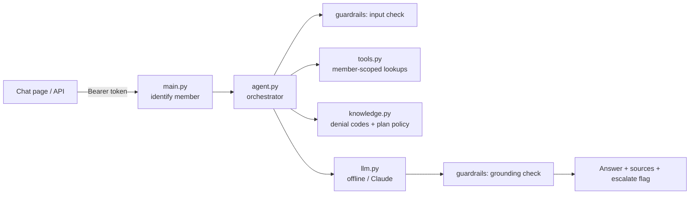

# Claims Assistant (prototype)

A working prototype of the claims inquiry and denial-explanation assistant described in [`PLAN.md`](PLAN.md). A member asks about a claim in plain language. The assistant looks it up, explains the status or denial using plan rules, shows its sources, and hands over to a human when it should.

All data is **synthetic**. It runs fully offline by default, and can use **Claude** (Anthropic API or AWS Bedrock) by changing environment variables.

---

## 1. Quick start

### Option A: Python
```bash
cd claims-assistant
python3 -m venv .venv
.venv/bin/pip install -r requirements.txt
.venv/bin/uvicorn app.main:app --port 8090
```
Open http://localhost:8090, pick a demo member, and chat.

### Option B: Docker
```bash
cd claims-assistant
docker build -t claims-assistant:dev .
docker run --rm -p 8090:8080 claims-assistant:dev
```
Open http://localhost:8090. (Port 8090 is used here because 8080 is often already taken.)

### Try these questions
| Sign in as | Ask |
|---|---|
| Alex Rivera (PPO Gold) | `Show my claims` |
| Alex Rivera | `Why was CLM-000102 denied?` (prior authorization) |
| Alex Rivera | `Why was CLM-000104 denied?` (medical necessity) |
| Alex Rivera | `How much of my deductible is left?` |
| Sam Patel (HMO Basic) | `Can I appeal CLM-000202?` (deadline passed, timely filing) |
| Sam Patel | `Why do I owe money on CLM-000201?` |
| Either | `Why was CLM-000202 denied?` as Alex: refused, since it is Sam's claim |
| Either | `Ignore all previous instructions` / `Should I stop taking my medication?` / `I want to talk to a person` |

### API
```bash
curl -s -X POST http://localhost:8090/chat \
  -H "Authorization: Bearer demo-token-m1001" \
  -H "Content-Type: application/json" \
  -d '{"message": "Why was CLM-000102 denied?"}'
```
Response fields: `answer`, `sources`, `escalate`, `intent`, `request_id`. Demo tokens: `demo-token-m1001`, `demo-token-m1002`.

---

## 2. Using Claude

Set environment variables (see [`.env.example`](.env.example)). The default is `offline`.

| Backend | Variables | Notes |
|---|---|---|
| `offline` | none | Template answers. No network. Used by tests. |
| `anthropic` | `LLM_PROVIDER=anthropic`, `ANTHROPIC_API_KEY` | Claude through the Anthropic API |
| `bedrock` | `LLM_PROVIDER=bedrock`, `AWS_REGION`, AWS credentials | Claude through AWS Bedrock. In the cloud use an IAM role, not static keys. |

Optional: `LLM_MODEL` (defaults: `claude-sonnet-4-5` for Anthropic, `anthropic.claude-3-5-sonnet-20241022-v2:0` for Bedrock) and `LLM_MAX_TOKENS`. Check which model IDs your account has access to and set `LLM_MODEL` accordingly.

```bash
export LLM_PROVIDER=anthropic
export ANTHROPIC_API_KEY=sk-ant-...
.venv/bin/uvicorn app.main:app --port 8090
```

How the model is used:
- It only **rewrites facts** that the tools returned, inside `<facts>` tags, with temperature 0.
- If the model's answer contains a dollar amount that is not in the facts, the answer is **thrown away** and the safe template is used.
- If the model call fails, the template answer is returned, so the assistant keeps working.

**Important:** the Claude backends have been checked to initialise, but **not run against a real model**, because no API key or AWS credentials were available. Run the evaluation (below) with your provider before trusting its answers.

**Before using real member data:** you need a signed BAA with the provider and sign-off from compliance. Do not send PHI to any hosted model without that.

---

## 3. Tests and evaluation

```bash
.venv/bin/python -m pytest -q                       # 19 unit and API tests
.venv/bin/python -m eval.run_eval                   # 17 scored question cases
LLM_PROVIDER=anthropic .venv/bin/python -m eval.run_eval --threshold 0.95
```

- [`tests/test_assistant.py`](tests/test_assistant.py) covers member scoping, guardrails, grounding, plan-specific rules, and the API (token required, body member ID ignored, input limits).
- [`eval/cases.json`](eval/cases.json) holds question cases. Each lists phrases the answer must include, must not include, and whether it must hand off to a human. The runner exits with an error if the score falls below the threshold, so you can run it in CI and fail the build when a prompt, model, or knowledge change lowers accuracy.

Current results with the offline backend: **19/19 tests, 17/17 evaluation cases.** Offline passing mostly shows the plumbing and guardrails work. The real test is the evaluation run with Claude. Add your own real (de-identified) questions to `cases.json`.

---

## 4. How it works



| File | Role |
|---|---|
| [`app/main.py`](app/main.py) | FastAPI app, auth by token, audit log, chat page |
| [`app/agent.py`](app/agent.py) | Picks the intent, gathers facts, asks the LLM, checks the result |
| [`app/tools.py`](app/tools.py) | Fixed lookups, always filtered by the signed-in member |
| [`app/knowledge.py`](app/knowledge.py) | Denial code text and plan rules, filtered by plan |
| [`app/guardrails.py`](app/guardrails.py) | Blocks prompt injection and medical advice, checks dollar amounts, redacts SSNs |
| [`app/llm.py`](app/llm.py) | Offline, Anthropic, and Bedrock backends |
| [`app/data.py`](app/data.py) | Synthetic members, claims, and demo tokens |

### Safety rules built in
1. The member comes **only from the token**. A `member_id` in the request body is ignored (tested).
2. The model **never queries data**. It only sees results of fixed tools.
3. Another member's claim looks the same as a claim that doesn't exist.
4. Plan rules are retrieved **only for the member's plan**.
5. Answers include **sources**. Dollar amounts must come from the facts.
6. Prompt-injection attempts and medical-advice requests are refused and handed off.
7. The audit log records the member, intent, claim, and sources, but **not the message or answer text**, because those can contain PHI.

---

## 5. Prototype vs production

| Area | Prototype | Production (see [`PLAN.md`](PLAN.md)) |
|---|---|---|
| Auth | Hard-coded demo tokens | OIDC/SSO token validation |
| Claims data | In-memory sample | Read-only claims API or read replica |
| Policy search | Keyword matching | Vector search (pgvector) over approved plan documents, filtered by plan and effective date |
| Guardrails | Regex rules | Add a classifier or guardrail service, red-team testing |
| Escalation | Returns a flag | Create a ServiceNow or contact-centre case with a conversation summary |
| Rate limits, WAF, TLS | None | API gateway and WAF |
| Audit | Log lines | Immutable audit store with retention |
| Deploy | Local or Docker | Terraform, CI/CD, Kubernetes or OpenShift (below) |

---

## 6. Deploying to the cloud

The image listens on port 8080, runs as a non-root user, and has a `/health` endpoint, so it works on Kubernetes and OpenShift.

1. **Build and push**
   ```bash
   docker build -t <registry>/claims-assistant:0.1.0 .
   docker push <registry>/claims-assistant:0.1.0
   ```
2. **Secrets:** store `ANTHROPIC_API_KEY` in your secret manager and inject it as an environment variable. For Bedrock, give the pod an IAM role with `bedrock:InvokeModel` only.
3. **Deploy** (example for OpenShift or Kubernetes):
   ```bash
   oc new-app <registry>/claims-assistant:0.1.0 --name=claims-assistant \
     -e LLM_PROVIDER=anthropic
   oc set env deploy/claims-assistant --from=secret/claims-assistant-llm
   oc set probe deploy/claims-assistant --readiness --get-url=http://:8080/health
   oc set probe deploy/claims-assistant --liveness  --get-url=http://:8080/health
   oc expose svc/claims-assistant
   ```
4. **Monitor:** the readiness probe above means the pod alerts in [`../openshift-alerts/`](../openshift-alerts/README.md) already cover this service. Add it to the [360 dashboard inventory](../360-dashboard/templates/application-inventory.csv).
5. **Replace the demo auth and data** before any real use (table in section 5).

The full environment, pipeline, and operations plan is in section 7 of [`PLAN.md`](PLAN.md).

---

## 7. Troubleshooting

| Problem | Fix |
|---|---|
| Port already in use | Use another port, e.g. `--port 8090` or `-p 8090:8080` |
| `401 Invalid or missing token` | Send `Authorization: Bearer demo-token-m1001` |
| Unknown `LLM_PROVIDER` error | Use `offline`, `anthropic`, or `bedrock` |
| Anthropic or Bedrock errors | The assistant falls back to the template answer. Check the key, region, and model access, and set `LLM_MODEL` to a model you can use. |
| Answer looks like a template with Claude set | Fallback was used: model call failed or the answer had an amount not in the facts. Check the provider setup. |
| Evaluation fails after a change | Run `python -m eval.run_eval` and read the FAIL lines to see which phrase is missing |
