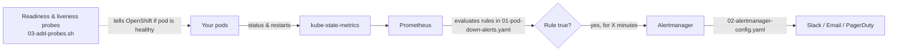

# Pod Down / Not Responding Alerts for OpenShift

Get an alert when any of your ~100 microservices has a pod that is **down** or **not responding**.

---

## 1. How it works



In plain words:

1. OpenShift already runs **Prometheus** (collects metrics) and **Alertmanager** (sends notifications). You do not install anything new.
2. **Probes** (health checks) tell OpenShift whether each pod actually responds. If a pod hangs, the probe fails and the pod is marked "not ready".
3. **Alert rules** watch those pod states. If a pod stays unhealthy longer than a set time, an alert fires.
4. **Alertmanager** sends the alert to Slack, email, or another channel.

One rule set covers **all** namespaces and pods, so you do not configure each of the 100 services separately.

---

## 2. Files in this folder

| File | What it is | Do you need to edit it? |
|------|-----------|------------------------|
| `01-pod-down-alerts.yaml` | The alert rules (what counts as "down") | Optional: change thresholds or namespace filter |
| `02-alertmanager-config.yaml` | Where alerts get sent (Slack, etc.) | **Yes**: add your Slack webhook URL or email |
| `03-add-probes.sh` | Script that adds health checks to your Deployments | Optional: set your health path/port |
| `README.md` | This guide | No |

---

## 3. Prerequisites

- `oc` CLI installed and logged in: `oc login <cluster-url>`
- **cluster-admin** access (needed for step 2 and 3 below, because they touch `openshift-monitoring`)
- OpenShift **4.11 or later** (see [Older OpenShift versions](#8-older-openshift-versions-below-411) otherwise)
- A Slack incoming webhook URL (or SMTP details for email)

Check you are logged in:
```bash
oc whoami
oc get nodes
```

---

## 4. Step-by-step setup

### Step 1: Add health probes to your services

**Why:** Without a readiness probe, OpenShift only knows if the process is *running*, not if it *responds*. A hung app would look healthy and never alert.

Preview first (changes nothing):
```bash
cd openshift-alerts
DRY_RUN=1 ./03-add-probes.sh <namespace> /health 8080
```

Apply:
```bash
./03-add-probes.sh <namespace> /health 8080
```

- `<namespace>`: the project holding your services, e.g. `shop`
- `/health`: your health endpoint (Spring Boot: `/actuator/health`, Node/Express: often `/healthz`)
- `8080`: the port your app listens on

Notes:
- The script **skips** Deployments that already have a readiness probe.
- It patches the **first container** of each Deployment.
- Run it once per namespace. If services use different ports or paths, patch those individually.
- Patching triggers a rolling restart of each updated Deployment.

Manual alternative (put this in each Deployment's container spec):
```yaml
readinessProbe:
  httpGet: { path: /health, port: 8080 }
  initialDelaySeconds: 10
  periodSeconds: 10
  failureThreshold: 3
livenessProbe:
  httpGet: { path: /health, port: 8080 }
  initialDelaySeconds: 30
  periodSeconds: 20
  failureThreshold: 3
```

| Probe | Meaning | What OpenShift does on failure |
|-------|---------|-------------------------------|
| **Readiness** | "Can you accept traffic right now?" | Removes pod from the Service, marks it *not ready* (triggers `PodNotReady` alert) |
| **Liveness** | "Are you stuck?" | Restarts the container |

### Step 2: Create the alert rules

```bash
oc apply -f 01-pod-down-alerts.yaml
```

Verify they loaded:
```bash
oc -n openshift-monitoring get prometheusrule microservice-pod-alerts
```
Or in the web console: **Observe → Alerting → Alerting rules**, search for `PodNotReady`.

### Step 3: Configure where alerts are sent

1. Open `02-alertmanager-config.yaml`.
2. Replace both `https://hooks.slack.com/services/REPLACE/ME/NOW` values with your Slack webhook URL.
3. Change the `channel:` names to yours.
4. **Back up and merge your existing config first** (the next command *replaces* it):
   ```bash
   oc -n openshift-monitoring get secret alertmanager-main \
     --template='{{ index .data "alertmanager.yaml" }}' | base64 -d > alertmanager-backup.yaml
   ```
   If the backup contains receivers you want to keep, copy them into `02-alertmanager-config.yaml`.
5. Apply:
   ```bash
   oc -n openshift-monitoring create secret generic alertmanager-main \
     --from-file=alertmanager.yaml=02-alertmanager-config.yaml \
     --dry-run=client -o=yaml | oc -n openshift-monitoring replace -f -
   ```

Prefer the UI? **Administration → Cluster Settings → Configuration → Alertmanager** lets you add receivers by form.

**Email instead of Slack:** see the commented `email_configs` block at the bottom of the file.

### Step 4: Test it

```bash
# Take one service down
oc -n <namespace> scale deploy/<service> --replicas=0
```
- After about **1 minute**, `DeploymentDown` goes *Pending*, then *Firing*.
- Check **Observe → Alerting → Alerts** in the console.
- You should get a Slack message shortly after.

Restore it:
```bash
oc -n <namespace> scale deploy/<service> --replicas=1
```
The alert auto-resolves and a "RESOLVED" message is sent.

---

## 5. What each alert means

| Alert | Fires when | Wait time | Severity | Typical cause | First thing to check |
|-------|-----------|-----------|----------|---------------|----------------------|
| **PodNotReady** | Pod is Running but readiness probe fails (**not responding**) | 2 min | critical | App hung, DB unreachable, slow startup | `oc logs <pod>`, `oc describe pod <pod>` |
| **PodNotRunning** | Pod is Pending / Failed / Unknown | 5 min | critical | No node capacity, bad PVC, node lost | `oc describe pod <pod>` → Events |
| **PodCrashLooping** | More than 3 restarts in 15 min | none | critical | App crashes on start, bad config | `oc logs <pod> --previous` |
| **PodContainerWaiting** | Stuck in CrashLoopBackOff, ImagePullBackOff, ErrImagePull, CreateContainerConfigError | 3 min | critical | Wrong image/tag, missing secret or configmap | `oc describe pod <pod>` |
| **ContainerOOMKilled** | Container restarted after exceeding memory limit | none | warning | Memory limit too low or leak | Raise `resources.limits.memory` |
| **DeploymentDown** | **Zero** available replicas | 1 min | critical | Total outage of that service | `oc get pods -n <ns>` |
| **DeploymentDegraded** | Available replicas < desired | 5 min | warning | Some pods failing, rollout stuck | `oc rollout status deploy/<svc>` |
| **StatefulSetReplicasUnavailable** | Ready replicas < desired | 5 min | warning | Stateful pod not starting | `oc describe sts <name>` |

**Wait time** = how long the problem must persist before alerting. This prevents false alarms from brief restarts or deployments.

**Severity routing:** `critical` → `#alerts-critical` Slack channel, `warning` → `#alerts-warning`.

---

## 6. Customising

### Only monitor certain namespaces
Each rule excludes platform namespaces with:
```
namespace!~"openshift-.*|kube-.*|default"
```
To monitor **only** your apps, replace that with an include filter, e.g.:
```
namespace=~"shop-.*|payments-.*"
```
Do a find-and-replace across `01-pod-down-alerts.yaml`, then `oc apply` again.

### Change timing
Edit the `for:` value on any rule (e.g. `for: 5m` → `for: 10m`) to be less or more sensitive.

### Exclude one noisy service
Add a label filter in the rule, e.g. `pod!~"batch-job-.*"`.

### Add a new alert
Copy an existing rule block under `rules:`, give it a new `alert:` name and `expr:`, and re-apply.

---

## 7. Troubleshooting

| Problem | Check |
|---------|-------|
| Rule not visible in console | `oc -n openshift-monitoring get prometheusrule`; confirm the `openshift.io/prometheus-rule-evaluation-scope: leaf-prometheus` label is present |
| Alert never fires during test | Make sure the Deployment has `spec.replicas > 0` originally; wait the full `for:` time; confirm namespace isn't excluded |
| Alert fires but no Slack message | Check the webhook URL; view Alertmanager logs: `oc -n openshift-monitoring logs alertmanager-main-0 -c alertmanager` |
| `PodNotReady` never fires for a hung app | The Deployment has no readiness probe. Run Step 1 |
| Too many alerts during deploys | Increase `for:` durations or `initialDelaySeconds` on probes |
| Permission denied on apply | You need cluster-admin for `openshift-monitoring` |
| Replaced Alertmanager config by mistake | Restore from `alertmanager-backup.yaml` using the same `create secret ... replace` command |

---

## 8. Older OpenShift versions (below 4.11)

The cluster-wide label is not supported. Instead:

1. Enable user-workload monitoring once:
   ```yaml
   apiVersion: v1
   kind: ConfigMap
   metadata:
     name: cluster-monitoring-config
     namespace: openshift-monitoring
   data:
     config.yaml: |
       enableUserWorkload: true
   ```
   ```bash
   oc apply -f <that-file>.yaml
   ```
2. In `01-pod-down-alerts.yaml`, change `namespace: openshift-monitoring` to your app namespace and remove the `openshift.io/prometheus-rule-evaluation-scope` label.
3. Apply it **once per application namespace**.

---

## 9. Optional: external "is it reachable?" check

The alerts above use internal pod state. To also test a service from the outside (via its Route), deploy a Prometheus **Blackbox Exporter** with a `Probe` object for each Route, then alert on:
```
probe_success == 0
```
Useful for catching networking or Route problems where pods look healthy.

---

## 10. Quick reference

```bash
# Apply everything
./03-add-probes.sh <ns> /health 8080
oc apply -f 01-pod-down-alerts.yaml
# edit Slack URL, then:
oc -n openshift-monitoring create secret generic alertmanager-main \
  --from-file=alertmanager.yaml=02-alertmanager-config.yaml \
  --dry-run=client -o=yaml | oc -n openshift-monitoring replace -f -

# Remove alerts
oc -n openshift-monitoring delete prometheusrule microservice-pod-alerts

# See currently firing alerts (console)
# Observe → Alerting → Alerts
```
